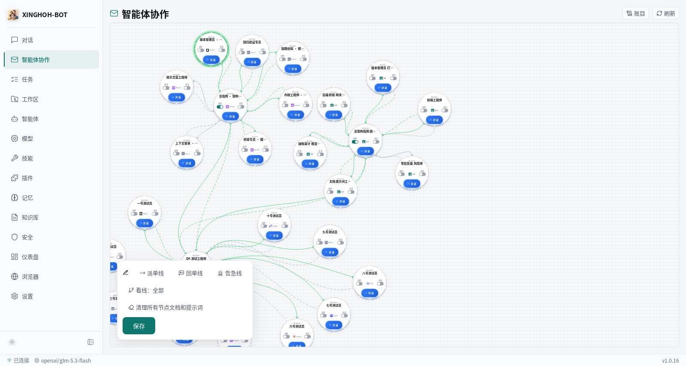

# XINGHOH-BOT

**本地优先的多智能体协作工作台（桌面客户端）**

XINGHOH-BOT 是一款运行在本机的智能体工作台：把多个各有分工的智能体放进同一张协作画布，用「派单 / 回单 / 告急」三条线组织任务流转，并允许把 Claude Code、Codex、DSH、Gemini、Hermes 等外部引擎直接接入同一套工作区。

- 数据保存在你自己的电脑上，不经过我们的服务器
- 没有账号体系，无需注册登录
- 没有埋点、没有行为分析、没有崩溃上报

> 本仓库是**官方发布与下载仓库**，只发布安装包与说明文档，**不包含源代码**。



---

## 下载

| 平台 | 版本 | 安装包 | 下载 |
| --- | --- | --- | --- |
| Windows 10/11 x64 | 1.0.11 | `XINGHOH-BOT_1.0.11_x64-setup.exe` | [前往 Releases](https://github.com/liuxiongfeiheting/xinghoh-downloads/releases/tag/v1.0.11) |
| Linux x86_64（Debian/Ubuntu） | 1.0.16 | `XINGHOH-BOT_1.0.16_amd64.deb` | [前往 Releases](https://github.com/liuxiongfeiheting/xinghoh-downloads/releases/tag/v1.0.16) |

所有版本都在 [Releases](https://github.com/liuxiongfeiheting/xinghoh-downloads/releases) 页面，安装包的 SHA-256 校验值见 [`SHA256SUMS.txt`](SHA256SUMS.txt)。

### 安装

**Linux（Debian / Ubuntu）**

```bash
sudo apt install ./XINGHOH-BOT_1.0.16_amd64.deb
```

**Windows**

双击 `XINGHOH-BOT_1.0.11_x64-setup.exe` 安装。首次运行如出现 SmartScreen 提示，请核对文件来源为我们仓库的 Releases 后再选择「仍要运行」。

### 运行要求

- Windows 10/11（64 位）或 Linux x86_64（Debian/Ubuntu 系）
- 约 2 GB 可用磁盘空间
- 需要自备大模型 API Key（如 DeepSeek、小米 MiMo 等），密钥只保存在操作系统凭据库中，不写入明文数据库
- 部分能力依赖本机已安装的 Node.js / Python 运行时，应用内提供一键安装入口

---

## 主要能力

- **多智能体协作画布**：把智能体放进同一张画布，用派单线、回单线、告急线定义流转关系；每个节点可单独开关「指挥」「审查」权限。
- **外部引擎接入**：通过 ACP 接入 Claude Code、Codex、DSH、Gemini、Hermes、OpenCode 等命令行智能体，与内置智能体共用工作区和任务。
- **模型中心**：自定义模型供应商与模型卡，按智能体分别指定模型，统计调用量。
- **工作区与任务**：把本机目录作为工作区，任务、运行记录、检查点统一管理。
- **技能与插件**：把常用流程沉淀为技能，按需挂载给 Agent；插件扩展工具面。
- **记忆与知识库**：分层记忆条目、向量索引、知识库文件统一归本地管理。
- **安全与审计**：操作审计日志、工具副作用台账、敏感信息扫描。
- **本地优先**：全部数据位于本机用户目录，删除该目录即彻底删除全部数据。

---

## 更新版本

新版本会发布在本仓库的 [Releases](https://github.com/liuxiongfeiheting/xinghoh-downloads/releases) 页面。更新方式：

1. 打开 Releases，下载对应平台的最新安装包；
2. 关闭正在运行的 XINGHOH-BOT；
3. 直接覆盖安装，原有数据与配置会保留在 `~/.xinghoh-bot/`（Linux）或用户目录下的 `.xinghoh-bot\`（Windows）。

历史版本的构建时间与校验值见 [`CHANGELOG.md`](CHANGELOG.md)。

---

## 隐私

本软件是本地软件，不采集、不上传、不留存你的任何数据。完整说明见 [PRIVACY.md](PRIVACY.md)。

## 许可

本软件为**专有软件（Proprietary Software）**，版权归 XINGHOH-BOT 项目所有者所有。本仓库仅用于分发官方安装包与文档：

- 允许下载、安装并在你拥有或控制的设备上使用本软件；
- 未经版权所有者事先书面许可，不得复制、修改、反编译、再分发、转售本软件或其任何部分，不得将其用于商业目的。

安装与使用前请阅读 [EULA.md](EULA.md)。第三方组件声明见 [THIRD-PARTY-NOTICES.md](THIRD-PARTY-NOTICES.md)。

## 反馈

使用问题与建议请通过本仓库的 [Issues](https://github.com/liuxiongfeiheting/xinghoh-downloads/issues) 提交。
